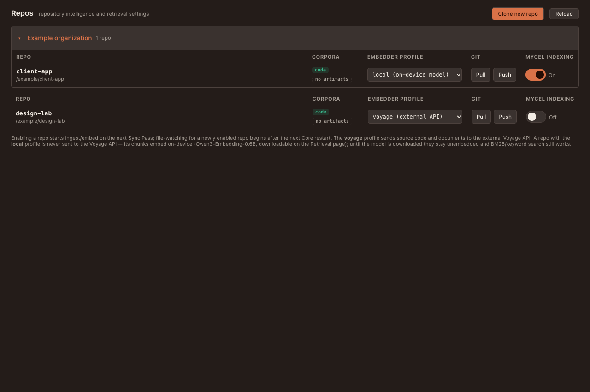

# Seqoya Lab

## Single-database release (ARC-4)

Open one Seqoya Lab window for the installation through Option+Q. Subscriptions, saved Vigor and Brain Recipe Routing use the same owner-only backend as Elma and the CLI. The header contains the Seqoya identity, theme, text size and navigation controls. The navigation rail starts with the compact Seqoya Insignia. Its smaller serif title scales with the window text size and balances wrapped lines. A short rule sits beside the Seqoya wordmark, and the flask-and-seedling watermark is subdued. The content pane starts with the tabs. The selected tab sets the Insignia title to **Providers Subscriptions Metrics**, **Subscriptions Vigor Pressure**, or **Subscription and Model routing**. Subscriptions is the landing tab. Show installation-wide account activity and **Arbol activity · Last 30 days**.

Refresh reads saved account and Vigor data. Each supported usage action targets its Driver and Subscription explicitly. Match asynchronous responses to the current connection and the same account family and creation identity. Reconnect keeps saved readings visible, refreshes the installation account listing and prevents replies from an older connection from replacing current state. An empty installation can list signed-in subscriptions before any Vigor has been recorded. Show maintenance, unavailable database and missing readings distinctly. Optional allowance evidence uses the installation settings scope and the existing file and account-binding checks. Provider usage windows open in the subscription’s confirmed Arbol Browser profile.

The executable native tray preview raises one administration window. Elma supplies the compatible Trunk selector for new Exchanges.

<!-- sources:
arbol:@code/ui/elma/src/seqoya/App.svelte
arbol-app:@code/Sources/ElmaAppChannel.swift
arbol-app:@code/Sources/SeqoyaUsageEvidence.swift
arbol-app:@code/Sources/SubscriptionUsageBrowser.swift
-->

This applies to the release governed by ARC-4 upon its acceptance. The existing Root-based descriptions below retain their original release scope.

## First native layout

Seqoya Lab uses the same compact WorkspaceHeader as Elma Chat. It passes the Seqoya workspace identity and title to the component, which renders the mark, Trunk dropdown, theme and text size controls, and navigation control. Seqoya keeps its appearance for its own Root. The dropdown changes the Trunk for this window. New windows start with the tray’s default for their Root.

Intelligence Providers is the native page. Its tabs are Subscriptions, Vigor and Brain Recipe Routing, in that order. Subscriptions is selected at launch. Use the arrow keys, Home or End to move between tabs. The macOS app switcher shows Seqoya Lab while a Lab or subscription browser window is open. The native bundle and executable are named Seqoya Lab, matching the display name and app switcher identity. Each numbered Build has a distinct bundle version. The native icon uses the exact archived Seqoya flask and seedling glyph from `heritage/renderer/apps/seqoya/src/SeqoyaGlyph.svelte`, exported as `src/assets/SeqoyaLab.png`. Brain Recipe Routing has a placeholder. The **Pages / Seqoya / Dashboard / Lab Layout** story shows the layout with fictional accounts and Vigor results.

## Subscriptions

The Subscriptions tab loads the accounts reported by the selected Root. Each card has one subscription heading without a provider subtitle. Its body shows one section per current or next allowance window in end order. A positive **Available limit resets** count appears at the bottom with the known unexpired grants and their expiry times.

Each window shows its length, reset and expiration, time remaining, usage percentages, estimated output-token equivalents and remaining equivalents per hour when known. A passed window’s figures disappear. Show the projected next interval for known recurring resets, the next use state for a rolling reset, or a pending reading when the next grant is unknown. Current readings supersede estimates. Show the allowance expiry only when it is known or applies to a terminal allowance; retain the unknown DeepSeek API expiry. All date/time values use local 24-hour time without a timezone or year: HH:mm today, Tomorrow HH:mm tomorrow, and D MMM, HH:mm otherwise. Use k/M for token figures, for example ≈ 1.28M and ≈ 16.8k/hour. Keep estimate context on the figures.

The Subscriptions page has one Refresh action. It rereads stored accounts and refreshes the configured Browser dashboards. Keep the last usable reading after a failure or disconnect. Each supported card has an Open in provider button, which shows the usage page in that subscription’s existing Arbol Browser profile. Label the pending action “Verifying and opening…”. Confirm a verified handoff with “Opened in Arbol Browser.” on the same card. Report a failure on its own card.

An explicit subscription open brings the existing Browser window forward. If the Browser is closed, the App gives its profile controls native focus while Chromium starts. Account verification continues while the window is available. Once the dashboard is ready, the Browser selects its profile and tab in the same window. Reopening the same dashboard reuses its ready tab. An empty subscription profile opens its saved dashboard as its first tab. Returning to a profile with live tabs resumes its selected tab.

Order the cards by driver and vendor family as Claude Code, Codex, Pi/ChatGPT, Kimi Code, z.ai, MiMo, DeepSeek and MiniMax. Other accounts keep their alphabetical fallback. Editing a display name does not change its provider position.

DeepSeek and MiniMax API cards show used and available output-token estimates and a single progress bar since the latest successful balance top-up. The model rate and starting-balance assumptions are available on the estimate. Show the available-token estimate when payment history is missing. These cards have no timed allowance sections. For timed plans, calculate the token figures from the current share and applicable calibration or published credit conversion. Mark a figure unavailable when the necessary reading is missing.

The **Pages / Seqoya / Subscriptions** stories show current and next allowances, reset inventories, loading, empty, partial, unavailable, stale and disconnected states, and the pending and completed Browser handoff.

## Vigor

Vigor shows a compact ranked list for the window’s Root. Each row shows the account, score and relevant status. Activate the row to expand its calculation. Show the stale report age, predicted windows, exhaustion and the next reset or recovery with the projected score when available. Substitute the saved used share and the remaining and total minutes into the loss formula. Use the saved calculation time. Show each weight multiplied by its loss and the sum capped at one. Older records may provide only the saved results.

Label a provisional score Estimated and explain which data was used. For a balance estimate, substitute the balance and price into the token conversion and the estimated tokens into the score formula. Show zero for an exhausted account. Reserve Unavailable for an account known to be inactive. In the Pi ChatGPT and MiMo details, show the last 30 days of Arbol activity in this Root, including runs and reported token counts.

Expanded rows show saved allowance details. Show the dated calibration, reference model, assumptions and arithmetic for capacity estimates. These estimates are informational in Vigor. Keep the provider’s quota units visible and report what prevents a conversion when evidence is missing.

Read saved results on tab entry and Refresh. Keep the previous results visible with a warning when a reread fails. Show Driver failures alongside the results that arrived. The **Pages / Seqoya / Vigor** stories show the ranked list, loading, empty, partial and failed refresh states.

## Observed structure

Administration workspace with shared shell, a left navigation/insignia panel and selected page. The header supplies a repository picker; repository-dependent knowledge pages require a repository context. The navigation contains **17 destinations**. Dashboard is implemented, despite the historical guide calling it a placeholder. Monitoring contains Event Stream and Journal Log; event/history inspection now lives here rather than defining Willo's current purpose.

<!-- sources:
arbol:renderer/apps/seqoya/src/App.svelte
arbol:renderer/apps/seqoya/src/nav/NavigationPanel.svelte
arbol:renderer/apps/seqoya/src/pages/Dashboard.svelte
arbol:renderer/apps/seqoya/src/pages/Monitoring.svelte
-->

## Page inventory and successor mapping

| Destination | Observed UX and actions | Proposed common pattern |
|---|---|---|
| Dashboard | Knowledge health, recent activity, shortcut to providers | Overview cards; honest freshness and actionable failures |
| Intelligence Providers | Subscription usage rows; configured provider cards; enable/disable, Test and Edit | Two related collections, keeping account and route distinct |
| Brain Recipes | Global fallback, recipes, create/edit dialog, ordered conditional assignments and delete confirmation | Collection + full-page rule editor; explicit priority/order |
| Quick Text | Shortcut/content rows; enable, edit, delete; custom popup form; `!@` activation keys | Collection + medium EntityEditor; preview insertion behavior |
| Feature Toggles | Feature cards and Cue Detection Catalog | Settings list with scope, current state and reason |
| Living Topics | Create/edit fields, expandable topic cards, Chat, link/unlink entity, delete | Collection + DetailPane with relations |
| Stewardship | Activation Rules, Stewards and Mandates; mission, metadata, instruction files, held permissions and definitions | Not carried into the successor: Stewards, Activation Rules and Mandates were removed on 15 November 2026 |
| Blueprints | Inline typed contract editor with inputs, outputs, recipes, restrictions, done-when and Markdown instructions | Collection + full-page structured document editor |
| Reactions | Signal automation summaries | Read-only collection/detail unless editing is actually supported |
| Organizations | Create/edit organization; root/URL/fork identity; repo grouping, VIP/ignored; pull/push and progress | Collection + organization editor + nested RepoCollection |
| Repos | Standalone/organization repositories; corpora, embedder profile, Git and indexing; clone flow | Comparable table + Clone operation dialog |
| Secrets | Provider/integration credentials, configuration, connection checks and Telegram sign-in steps | Credential settings with concealed input + explicit connection state |
| Chunks Viewer | Repository corpus records with current-page text filtering | Table + inspector, visibly scoped search |
| Refresher | Open drift/freshness information and refresh operations | Issue collection + progress/detail |
| Artifacts | Corpus file tree, rendered document/editing, refresh and context actions | Tree + shared DocumentView |
| Retrieval | Embedding status and actions, text and code search | Operation panels + result collection; costs/scope before a run |
| Monitoring | Activity/history table and journal table; filters and detail payloads | Shared log-table/inspector recipe |

These rows summarize actual page surfaces; they do not claim all remote operations currently succeed. Exact fields/actions and page-local styles are retained in the source archive.

<!-- sources:
arbol:renderer/apps/seqoya/src/pages/BrainRecipes.svelte
arbol:renderer/apps/seqoya/src/pages/QuickText.svelte
arbol:renderer/apps/seqoya/src/pages/FeatureToggles.svelte
arbol:renderer/apps/seqoya/src/pages/LivingTopics.svelte
arbol:renderer/apps/seqoya/src/pages/Stewardship.svelte
arbol:renderer/apps/seqoya/src/pages/Blueprints.svelte
arbol:renderer/apps/seqoya/src/pages/Reactions.svelte
arbol:renderer/apps/seqoya/src/pages/Organizations.svelte
arbol:renderer/apps/seqoya/src/pages/Repos.svelte
arbol:renderer/apps/seqoya/src/pages/Secrets.svelte
arbol:renderer/apps/seqoya/src/pages/ChunksViewer.svelte
arbol:renderer/apps/seqoya/src/pages/Refresher.svelte
arbol:renderer/apps/seqoya/src/pages/Artifacts.svelte
arbol:renderer/apps/seqoya/src/pages/Retrieval.svelte
arbol:renderer/apps/seqoya/src/pages/EventMonitor.svelte
arbol:renderer/apps/seqoya/src/pages/LogJournal.svelte
-->

## Provider/account workflow to preserve

A subscription is an account/authentication/usage unit; a configured Intelligence Provider is a route using one subscription. Preserve the distinction even if labels simplify to Accounts and Providers. Subscription rows have provider-dependent login/logout, refresh, usage meters and expandable last-request information. IP cards show route information and testing state. Existing IPs are edited; the observed settings workflow is not a general provider-creation UI.

The IP editor includes subscription binding; global default; default/prohibited repositories; default model; available models and enabled thinking levels; and full permissions. It can fetch model catalogs and retain saved values. Repository default/prohibited conflicts are exposed, with prohibited winning. Saving currently submits IP settings and repository rules separately; the successor must provide atomic save or explicit partial-success recovery. A generic “saved” message must not hide that distinction.

Proposed field order: Identity/account → Model and reasoning → Repository routing → Advanced permissions. Put the model catalog into an editor section/page rather than a large popup within a popup. Model availability and capability come from provider data, not a frozen design-system enum. Preserve recognizable historical provider labels only for archived records when a route is retired.

<!-- sources:
arbol:renderer/apps/seqoya/src/pages/IntelligenceProviders.svelte
arbol:renderer/apps/seqoya/src/pages/SubscriptionRow.svelte
arbol:renderer/apps/seqoya/src/pages/IpCard.svelte
arbol:renderer/apps/seqoya/src/pages/ip-edit/IntelligenceProviderEditModal.svelte
arbol:renderer/packages/design-system/src/providers.ts
-->

## Proposed navigation and layout

Group destinations under Intelligence (Providers, Recipes), Workspace (Organizations, Repos, Quick Text, Living Topics), Automation (Blueprints, Reactions), Knowledge (Artifacts, Chunks, Refresher, Retrieval), and System (Dashboard, Secrets, Feature Toggles, Monitoring). Grouping does not change entity ownership. Keep global settings visibly global; show repository scope only where meaningful.

Use the standard collection toolbar and editor hosts. Primary New/Create sits in the page header. Refresh is secondary. Editing a row should preserve its collection filter and selection, with a Back/Cancel path that returns to the same record. Lengthy Blueprints and recipes get full pages; short Quick Text and organization identity use dialogs. Credential input never displays a saved secret; show “Configured”, replace and remove actions with clear result feedback.

## Restoration scenarios

Test one account unavailable, usage unknown, expired authentication, provider test failure, unknown saved model, conflicting repo rules, partial settings save, failed clone/pull, duplicate organization name, missing artifact, stale knowledge results and a long recipe with reordered rules. The view must preserve unsaved work and distinguish missing data from a real zero.

## Captured visual reference

Current Repos component with fictional data; theme applied by the capture harness, without app shell.

Compare the separately authored [successor specimen](reference.html) and see [capture provenance](assets/README.md).
