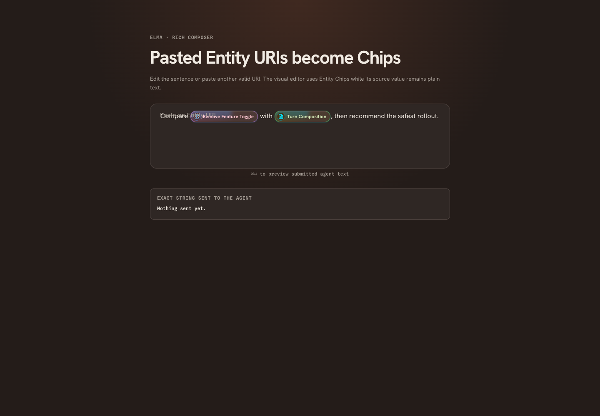

# Elma Chat

## Observed composition

Elma is a turn-oriented conversation workspace, not simply a scrolling messaging app. A navigation rail exposes repositories, turn-history controls, intelligence settings and Meta Cockpit. The main page combines context, the selected user message, assistant response, live state and composer. Turn and branch controls choose the visible path. A right pane shows a file/document or Thread Inspector; it may become fullscreen. Shared header/status chrome surrounds the workspace.

An empty chat uses a larger composer. Active chat uses a smaller composer with collapse/expand behavior. Response content has its own scroll region and reading-width limit. Elma separately persists UI scale, response scale and reading width.

<!-- Historical locators from the frozen version1 reference:
arbol_deprecated_v1:renderer/apps/elma/src/App.svelte
arbol_deprecated_v1:renderer/apps/elma/src/pages/ElmaPage.svelte
arbol_deprecated_v1:renderer/apps/elma/src/nav/NavigationPanel.svelte
arbol_deprecated_v1:renderer/apps/elma/src/nav/MetaCockpit.svelte
arbol_deprecated_v1:renderer/apps/elma/src/chat/ResponseView.svelte
arbol_deprecated_v1:renderer/apps/elma/src/chat/SplitColumns.svelte
-->

## Accepted First Sapling window

BKD-2/BKD-D18/BKD-D22, accepted19 October2026, govern Arbol2's first window. The maintained ElmaFrame shares WorkspaceShell's layout and narrow-navigation behavior while supplying Elma's40px chrome, Root display name/state, one-chat navigation, cockpit, readonly repository slots, History and Subscription-based Intelligence. It shows no list of chats. Repositories and Intelligence open for an empty chat and close on its first Exchange. Header controls preserve the720px default reading width (600–1680 in120px steps) and independent UI/response text scaling, with the twelve wood themes. Width shrinks to its container. Native traffic-light/window control behavior stays with the native adapter.

ElmaFrame's Empty, Conversation, Preparing, Failed and Working stories are fictional local presentations. Production filesystem discovery, routing defaults, persistence and Bridge lifecycle belong to the application adapter; the maintained component does not read a real backend or store conversation content. The later proposals below and historical branch/attachment/permission surfaces are not additions to First Sapling's accepted scope.

<!-- sources:
arbol-design-system:src/sections/ElmaFrame.svelte
arbol-design-system:src/patterns/WorkspaceShell.svelte
arbol-design-system:src/stories/ElmaFrame.stories.ts
-->

## Accepted Exchange navigation

PinnedMessage keeps the prompt at three lines until See more, retains its own expanded scroll area, and offers Copy prompt with a truthful copy result. TurnNavigator uses the one-based place among unreplaced Exchanges and the chat's full count, with the compact ‹n/N› counter opening history. HistoryTree's accepted mode is a newest-first list, digit shortcuts and Search of loaded prompts; older pages load explicitly in12-Exchange batches through the application. A separate AdvancedRootProposal story preserves the wider branching discussion without enabling branches in First Sapling.

The elma-new-chat, elma-conversation and elma-history pages compose the shared ElmaFrame and these controls directly, rather than a workspace list of chat pages. Composer has a FirstSapling fixture variant with multiline text, Return/Escape and send shortcuts and no Send button or attachments. These fixtures change local state only; backend Draft/send ownership remains in the application adapter. The broader composer default story is retained as a separate proposal.

<!-- sources:
arbol-design-system:src/sections/PinnedMessage.svelte
arbol-design-system:src/sections/HistoryTree.svelte
arbol-design-system:src/sections/TurnNavigator.svelte
arbol-design-system:src/sections/ConversationWorkspace.svelte
arbol-design-system:scripts/check-elma.mjs
-->

## Accepted repository controls

A repository slot click moves an existing chat only after the continuity warning in ConfirmAction; its action uses the primary tone and Cancel receives initial focus. Escape/Cancel restore focus to the slot. The parent guards the Root/chat identity and active Exchange state and supplies the real settings result. Cmd1–9 always starts the repository’s new-chat composition and brings back its Draft; Other/Cmd0 delegate the native folder picker to the application. ConversationWorkspace keeps only local fictional repository Drafts and confirmation state. The application’s relay adapter labels its folder prompt and sends no app-channel envelope to the backend.

<!-- sources:
arbol-design-system:src/patterns/ConfirmAction.svelte
arbol-design-system:src/sections/ConversationWorkspace.svelte
arbol-design-system:src/stories/ConfirmAction.stories.ts
arbol-design-system:scripts/check-elma-repositories.mjs
-->

## Accepted Intelligence controls

ElmaFrame exposes controlled Subscription rows and next-model/next-effort actions, with disabled unavailable rows, Loading models, Saving route and visible catalog failures with Retry models. ConversationWorkspace and the InteractiveIntelligence/CatalogFailure stories own fictional routes locally and exercise Ctrl1–9, CtrlM and CtrlTab; production catalog/default resolution and ordered chat settings writes belong to the application. Changing a route resets model/effort to its defaults; model changes reset effort to that model’s default. A catalog without a default does not authorize inventing one. The current Exchange keeps its captured route while choices apply to the next message.

<!-- sources:
arbol-design-system:src/sections/ElmaFrame.svelte
arbol-design-system:src/sections/ConversationWorkspace.svelte
arbol-design-system:src/stories/ElmaFrame.stories.ts
arbol-design-system:scripts/check-elma-routing.mjs
-->

## Accepted composer presentation

The First Sapling Composer is controlled: its parent owns the text, loading and busy state, errors, paste handling and send receipt. An empty chat centers a ten-line field below its repository/route caption. A conversation starts with the closed composer and working scroll-to-top/bottom controls; plain Return opens a three-line field, Escape collapses it without losing text, and a supplied Draft opens in focus. Return inside the field inserts a newline; Cmd/Control+Enter requests sending. Return on another control and keys inside an open dialog keep their own behavior. Loading or uncertain sending keeps text read-only. The application enables editing only after it has acquired its canonical Draft revision.

Composer's FirstSapling, Closed, WithDraft, LoadingDraft, Waiting and SaveFailed stories use an explicit fictional local owner. ConversationWorkspace also binds its local text rather than relying on a hidden component copy. These fixtures have no production persistence or backend outcomes. RecoverUnsaved offers the unsaved text with Restore text/Discard while the field stays read-only; the parent offers it only over its matching canonical revision. SavingPaste keeps typed text visible with Saving pasted text… and queues a fictional send once; PasteFailed retains its text with a visible error. The parent controls when an actual send closes the composer. Controlled value changes preserve the caret through file-link insertion, and native edit ranges accompany input so repeated characters do not confuse pending pasted ranges. Empty composers scroll vertically when text scaling and recovery controls need more room. ChangedElsewhere displays both exact texts with Keep mine and Take theirs; the parent supplies revision handling, and the fictional owner resolves only local text. The default attachment composer remains a broader proposal. `check-elma-composer.mjs` exercises focus, multiline editing, both send shortcuts, collapse/retention, scroll callbacks and narrow 200% text.

<!-- sources:
arbol-design-system:src/sections/Composer.svelte
arbol-design-system:src/examples/ComposerExample.svelte
arbol-design-system:src/stories/Composer.stories.ts
arbol-design-system:src/sections/ConversationWorkspace.svelte
arbol-design-system:scripts/check-elma-composer.mjs
-->

## Accepted agent questions

AskUserQuestion’s controlled First Sapling mode validates the public Ask shape and renders headers, question text, single radio or multiple checkbox choices, and no free-text answer. Submit requires a choice for every question with options; Continue answers the questions without options. Cancel declines. The parent supplies pending state, a recorded answer, closure and refusal; a successful control call alone never creates Your answer. A refusal keeps choices available, including after an earlier recorded answer. Closed recorded questions remain readable. Unknown/malformed Ask data stays literal with Cancel for its known ask identifier and no invented option. The original density/custom example remains a separate broader proposal.

QuestionExample and its FirstSapling/Multiple/Continue/Refused/RecordedAnswer/Unknown stories use explicit local buttons to simulate file facts; they contact no backend. The production adapter fences each submission against actual answer/control-refused file positions so an old answer cannot acknowledge a later retry.

<!-- sources:
arbol-design-system:src/sections/AskUserQuestion.svelte
arbol-design-system:src/sections/elma-response.ts
arbol-design-system:src/sections/Response.svelte
arbol-design-system:src/fixtures/QuestionExample.svelte
arbol-design-system:src/stories/AskUserQuestion.stories.ts
arbol-design-system:scripts/check-elma-questions.mjs
-->

## Accepted sending states

A busy First Sapling composer is closed and cannot be reopened for editing while its send receipt is unconfirmed; its parent retains the captured text. WaitingReceipt and SendRefused show the waiting status and the exact restored message respectively. The application owns persistent request identifiers, retry after an uncertain receipt, a provisional Exchange without a fabricated acceptance time, and reconciliation with canonical chat/Draft data. The shared component emits a send request but does not clear text or infer acceptance.

StopCurrentResponse uses the same ConfirmAction with initial Cancel and a primary Confirm action. Its fictional result says that stopping was requested and waits for a saved end; it does not pretend that the agent stopped. The Stopping response has no Stopped line; SavedCancellation shows Canceled and ⏹ Stopped only from a saved cancelled Exchange. A completion that won the race remains Completed, and a forced interruption remains Interrupted. CmdEscape is supplied by the application, which coalesces requests and retries an uncertain stop only on a new backend hello. The application releases a queued message only from saved terminal data, including when the stop reply or folder end arrived earlier.

<!-- sources:
arbol-design-system:src/sections/Composer.svelte
arbol-design-system:src/examples/ComposerExample.svelte
arbol-design-system:src/stories/Composer.stories.ts
arbol-design-system:src/stories/ConfirmAction.stories.ts
arbol-design-system:scripts/check-elma-composer.mjs
arbol-design-system:scripts/check-elma-repositories.mjs
-->

## Accepted response presentation

Response consumes typed blocks from an application adapter. While running it preserves their arrival order; after completion, open reasoning and closed tool rows stand above the Answer Threshold, with the answer's Markdown below it and Copy answer copying only that answer source. Lifecycle labels group actual times within three seconds. ToolCall exposes known times, elapsed running time after60 seconds, parallel progress, input/output, interrupted/failed and Driver-truncated marks. A cut Bridge preview loads its complete details only on opening, retains null/false values, and reports a failed load with an explicit retry. Saved Root rows have no tool timestamps: the component says Not recorded instead of inventing them.

SafeMarkdown uses a pinned CommonMark syntax-tree parser plus GFM tables and maps it into an allowlist of typed text/elements. It never inserts HTML strings. Raw HTML and image syntax remain text; only http/https links are buttons with link semantics routed through the application adapter. Failed or deeply nested parsing falls back to the complete source text. Code and table regions stay keyboard reachable and scroll inside their own boundaries. Standalone link stories only select fictional links locally; the application supplies the real app channel. The Answer Beacon delegates its scroll target to the reading-area owner.

The live adapter treats whole text/thinking as authoritative, nests sub-agent activity inside its parent tool, replaces usage totals per run and discards duplicate file positions. A new snapshot resets that projection. Saving replaces the answer with the saved rows while keeping already shown reasoning and actual tool times until the next snapshot. Response presents plain-language questions/options and the answer given above the future composer; answering controls belong to the application integration. NotSaved and Interrupted stories distinguish an uncommitted folder answer from a saved terminal Exchange. Status precedence is failed, stopping, waiting for an answer, starting, tools, thinking, responding, other work, then saved completion; no display clock ends a long wait.

ResponseReader owns the bounded reading region used by the application and the three accepted pages. Live answers follow their end until an upward wheel/touch/scrolling-key action; completion keeps an intentional reading position. A newly opened completed answer locates its threshold, including delayed layout/font changes, and the Beacon appears only while that threshold is below the view. Cmd+Shift+Option+8/7 move among activity start, answer threshold and response end. Offsets and following intent are kept in memory per chat/Exchange while the window lives, with no answer content stored as a convenience. Snapshots refresh open tool detail and restore an older selected Exchange from fresh12-row pages when needed. ReadingExample is fictional and local; its controls append text or switch examples without a real backend.

<!-- sources:
arbol-design-system:src/sections/Response.svelte
arbol-design-system:src/sections/ToolCall.svelte
arbol-design-system:src/sections/ResponseReader.svelte
arbol-design-system:src/components/SafeMarkdown.svelte
arbol-design-system:src/markdown.ts
arbol-design-system:src/sections/elma-response.ts
arbol-design-system:src/fixtures/ReadingExample.svelte
arbol-design-system:scripts/check-elma-response.mjs
arbol-design-system:scripts/check-elma-reading.mjs
arbol-design-system:src/styles/tokens.css
-->

## Exact JSON values

The maintained stringifyJson helper uses pinned MIT lossless-json4.3.3 to render bigint adapter values as exact numeric JSON. ToolCall's ExactRevision fixture loads a fictional64-bit value locally and checks its final digits. The application's wire decoder owns the revision/baseRevision policy and CAS validation; the shared formatter has no backend services. The ordinary numeric and null/false tool presentations remain covered by the response checks.

<!-- sources:
arbol-design-system:src/json.ts
arbol-design-system:src/sections/elma-response.ts
arbol-design-system:src/stories/ToolCall.stories.ts
arbol-design-system:scripts/check-elma-response.mjs
-->

## Surface inventory

| Surface | What must survive reconstruction |
|---|---|
| Header/title and status | Named chat, workspace identity, live status, preferences and readable diagnostics |
| Repository navigation | New-chat shortcuts, folder choice, current working context; current code distinguishes click changing context from shortcut starting a chat |
| Intelligence controls | Provider, model and thinking selection; unavailable/retired route handling |
| Meta Cockpit | Session metadata, tags, parent reference and ongoing state |
| Context strip / attachments | Repository/route/model and attached entities, notes/images; removability before sending |
| Composer | Multiline draft, entity tokens, paste handling, image previews, send shortcut and retained draft |
| Pinned message / turn stepper | Current prompt, older/newer turns, selected turn index and jump history |
| Branch controls | Switch sibling branches, compose from a chosen point, pin/remove actions and consequence confirmation |
| Response | Markdown, code/tables, thinking blocks, tool rows, lifecycle messages and final answer cues |
| Approval dock | Tool decisions and structured user questions; pending/busy/resolved states |
| Agent status | Active work, waiting, failure explanation, Retry and Continue from failure point |
| View Page / SidePanel | Local file, Markdown/frontmatter/Blueprint presentation, copy path, edit, save state, back/forward, fullscreen and detach |
| Thread Inspector | Session/turn diagnostics; preserve as explicit advanced view |
| Activity graph / lifecycle log | Execution and relationship inspection; separate from ordinary response prose |
| History overlay | Branch/turn navigation without losing draft or reading position |
| Quick Actions / tagging | Searchable actions, tags and acknowledgment |
| Change Walkthrough | Target chooser, file rail, before/diff/with-changes modes, whitespace/context controls and ask-agent-about-selected-lines |
| Worktree diff mode | Existing alternative diff entry points retained in archive; do not infer future worktree architecture from this UI |

<!-- Historical locators from the frozen version1 reference:
arbol_deprecated_v1:renderer/apps/elma/src/chat/Composer.svelte
arbol_deprecated_v1:renderer/apps/elma/src/chat/EntityComposerInput.svelte
arbol_deprecated_v1:renderer/apps/elma/src/chat/AttachedContext.svelte
arbol_deprecated_v1:renderer/apps/elma/src/chat/PinnedMessage.svelte
arbol_deprecated_v1:renderer/apps/elma/src/chat/TurnStepper.svelte
arbol_deprecated_v1:renderer/apps/elma/src/chat/branching/BranchSwitcher.svelte
arbol_deprecated_v1:renderer/apps/elma/src/chat/HistoryOverlay.svelte
arbol_deprecated_v1:renderer/apps/elma/src/chat/ApprovalDock.svelte
arbol_deprecated_v1:renderer/apps/elma/src/chat/AskUserQuestionCard.svelte
arbol_deprecated_v1:renderer/apps/elma/src/chat/AgentStatusBar.svelte
arbol_deprecated_v1:renderer/apps/elma/src/chat/SidePanel.svelte
arbol_deprecated_v1:renderer/apps/elma/src/chat/ThreadInspector.svelte
arbol_deprecated_v1:renderer/apps/elma/src/chat/ActivityGraphPanel.svelte
arbol_deprecated_v1:renderer/apps/elma/src/change-walkthrough/ChangeWalkthroughPage.svelte
arbol_deprecated_v1:renderer/apps/elma/src/WorktreeDiffMode.svelte
-->

## Composer and continuity details

Observed image paste accepts PNG, JPEG, WebP and GIF, up to four images and 8 MiB per image in the composer. Large text paste has a separate temporary-file/link path. Entity-aware text and Chat Note paste preserve structured context. Send is Cmd/Control+Enter; ordinary multiline editing remains available. These numeric limits are historical product constraints, not timeless design tokens.

Drafts are associated with composer/chat identity, not merely a repository. Preserve draft text and attachments across switching, refresh and failure. A failed send must not erase the only copy. Retry reloads persisted image bytes and stops on attachment failure instead of silently sending incomplete content. Read receipts must refer to the displayed chat/projection, not whichever chat a stale request originally targeted.

<!-- Historical locators from the frozen version1 reference:
arbol_deprecated_v1:renderer/apps/elma/src/chat/Composer.svelte
arbol_deprecated_v1:renderer/apps/elma/src/chat/largeTextPaste.ts
arbol_deprecated_v1:renderer/apps/elma/src/chat/chatNoteClipboard.ts
arbol_deprecated_v1:renderer/apps/elma/src/app/draft-cache.ts
arbol_deprecated_v1:renderer/apps/elma/src/app/message-attachments.ts
arbol_deprecated_v1:renderer/apps/elma/src/app/read-receipt.ts
-->

## Proposed improvements

Keep turn/branch navigation, but label the selected branch and the consequence of editing an earlier turn. Offer a continuous transcript presentation as an optional future feature, not a prerequisite for restoring Elma. Do not conflate “new chat in repo” with “change this chat's working directory”: give them distinct visible actions; preserve shortcuts as accelerators only.

Move provider/model/thinking into one consistent Context bar, with advanced routing and permissions disclosed on demand. Put parent/ongoing metadata in a stable inspector section rather than allowing inherited state to look like the child's own execution state. Preserve tool detail for investigation, but default to concise status rows and a readable answer.

Use the shared PermissionRequest and ConfirmAction patterns. Require deliberate activation for destructive branch removal; keep its downstream-turn consequence in the confirmation. Separate Stop, Retry and Continue labels; specify whether retry creates a replacement turn or resumes a prior attempt. Keep task state authoritative and show “Status unavailable” rather than pretending to run indefinitely.

Unify SidePanel and the detached artifact window around DocumentView. Both should share navigation, find, copy path, dirty-state protection and save-error handling. The current SidePanel uses autosave state while the detached renderer exposes explicit saving; choose a documented policy and maintain it across both hosts.

<!-- Historical locators from the frozen version1 reference:
arbol_deprecated_v1:renderer/apps/elma/src/nav/NavigationPanel.svelte
arbol_deprecated_v1:renderer/apps/elma/src/nav/MetaCockpit.svelte
arbol_deprecated_v1:renderer/apps/elma/src/pages/ElmaPage.svelte
arbol_deprecated_v1:renderer/apps/elma/src/chat/SidePanel.svelte
arbol_deprecated_v1:renderer/apps/artifact/src/App.svelte
-->

## Layout and acceptance

Preserve the 720 px default reading column; let it shrink to its container and allow the user to widen it. The code's 600 px preference minimum must not force the entire window to overflow. On constrained widths, the inspector replaces the main area with Back to chat; the composer remains reachable when keyboard or text size changes.

Acceptance: fresh chat; long multiline draft; mixed entity/image context; failed attachment; retry; streaming while reading older output; branch switch with unsent draft; user question; tool permission resolved in another window; failed/stale execution; file autosave error; large diff; deleted file; narrow window; 200% text; reduced motion. Use the existing E2E fixtures as behavior references, not proof of the successor's correctness.

<!-- Historical locators from the frozen version1 reference:
arbol_deprecated_v1:renderer/apps/elma/src/app/chat-width.ts
arbol_deprecated_v1:renderer/apps/elma/e2e/response-autoscroll.e2e.mjs
arbol_deprecated_v1:renderer/apps/elma/e2e/draft-session-switch.e2e.mjs
arbol_deprecated_v1:renderer/apps/elma/e2e/side-panel-autosave.e2e.mjs
-->

## Captured visual reference

Current entity-composer Storybook fixture; this is a component view, not the entire chat window. The captured fixture shows overlapping text at the start of its input; this is retained as legacy evidence, not a target treatment.

Compare the separately authored [successor specimen](reference.html) and see [capture provenance](assets/README.md).

First Sapling failed responses keep the plain cause alongside the original code/message and recorded end time. Rate-limit reset times use that end plus retryAfterSeconds and remain fixed as the viewer’s clock moves; a missing end is Not recorded. Sign-in failures show the Driver command without running it. The adapter supplies Retry and Continue callbacks only for the last saved failed Exchange; shared controls can be disabled during unavailable/pending recovery. Retry replaces the same turn in its original folder, while Continue sends proceed in the current chat folder/route and preserves an independently composed Draft. Stories use local fictional callbacks only.

<!-- sources:
arbol-design-system:src/sections/Composer.svelte
arbol-design-system:src/sections/AskUserQuestion.svelte
arbol-design-system:src/sections/ElmaFrame.svelte
arbol-design-system:src/sections/Response.svelte
arbol-design-system:src/sections/elma-response.ts
arbol-design-system:src/sections/ConversationWorkspace.svelte
arbol-design-system:src/fixtures/QuestionExample.svelte
arbol-design-system:src/fixtures/FailureExample.svelte
arbol-design-system:scripts/check-elma-composer.mjs
arbol-design-system:scripts/check-elma-routing.mjs
arbol-design-system:scripts/check-elma-repositories.mjs
arbol-design-system:scripts/check-elma-questions.mjs
arbol-design-system:scripts/check-elma-failures.mjs
-->

Question identifiers are opaque strings. Selection lookup uses own properties so names such as __proto__ remain ordinary question data; outgoing answers preserve their exact identifiers.

First Sapling chat-title edits use controlled InlineRename with the canonical stored title (empty for an untitled chat), Unicode character counting and empty-title removal. Cmd-click or keyboard activation opens the header edit; Return/OK saves and Escape/Cancel dismisses before saving. Saving disables the editor, refusals retain its text and cause, and closing restores focus to the title control. The header remains a heading. Ongoing is a controlled cockpit pill with Alt0 and canonical-result notices. Production adapters own idempotent metadata requests, pending receipts/reload gates and Root/context/publication guards; composed previews use local fictional state.

Quick actions use the controlled shared CommandPalette rows (labels, optional details/shortcuts, disabled state and selection callbacks). Shift-Enter opens the menu; R starts inline rename, A opens archive confirmation and C requests copying the session ID. Arrow/Return and Escape retain modal focus behavior. Archive confirmation saves the current Draft, stops a running response and waits for its saved terminal state before the archived mark. While waiting it remains cancelable; the archive receipt must confirm archivedAt. A refused save/stop/archive keeps the chat and Draft. Successful archive forgets only chat-ID conveniences, then shows the same repository with its independent new-chat Draft. Shared stories simulate these operations locally and explicitly label clipboard/service boundaries.

Latest chats use the same controlled CommandPalette rows over the Elma window until the native panel exists. Ctrl-Shift-Cmd-C opens it; 1–9 and0 choose the first ten, arrows/Return reach every row, and Escape restores the trigger focus. Rows show the canonical title or Unicode placeholder, repository, route, last Exchange state and recorded activity age; absent time is explicitly unrecorded. The application bounds active canonical summaries to100, excludes the current chat, puts Root-local recently shown UUIDs first and otherwise sorts by activity. Snapshots replace state, changed rows merge, archived rows disappear and a fresh snapshot backfills them. UUID ordering is the only cached list convenience. Loading, empty, read failure/retry and selection-saving states stay explicit. The native reference uses the same list behavior with a visible browser-only boundary.

External open requests save the visible Draft and wait for unconfirmed sends/actions before taking the host request. A returned chat UUID or folder remains a Root-local routing target until actual opening succeeds, including across a page reload; no content is cached for this purpose. Concurrent notices are coalesced and processed serially, including a notice received during a take. A failed target read keeps the current transcript/subscription and exposes Retry opening and Dismiss request. A Draft conflict keeps the host request untaken. A visible saving/opening status lasts until the transition finishes and participates in the Build reload barrier. Shared stories simulate completion and refusal locally; actual Swift/Willo integration remains outside the browser fixture.

Shared Notice lines keep literal status/error messages, severity colors and optional standard Button actions together with wrapping at narrow widths. The application and local external-open fixtures use the same Notice source; unknown future attention kinds can reuse this message presentation without introducing a new workflow.

Intelligence refreshes only public accounts.list/catalog status on window visibility/focus and before activating a Subscription row. Concurrent refreshes coalesce, chosen routes/models and independent Drafts remain intact, and a late refresh cannot act in another context or Root. Disabled signed-out/signing-in/needs-attention rows keep the exact Claude/Codex/Pi sign-in command as text plus an explicit Refresh row action; Refresh accounts is also available for the whole list. No credential, sign-in code, Keychain access or native command execution occurs in this UI. Public read failures and unknown states remain visible without claiming a new sign-in state.
