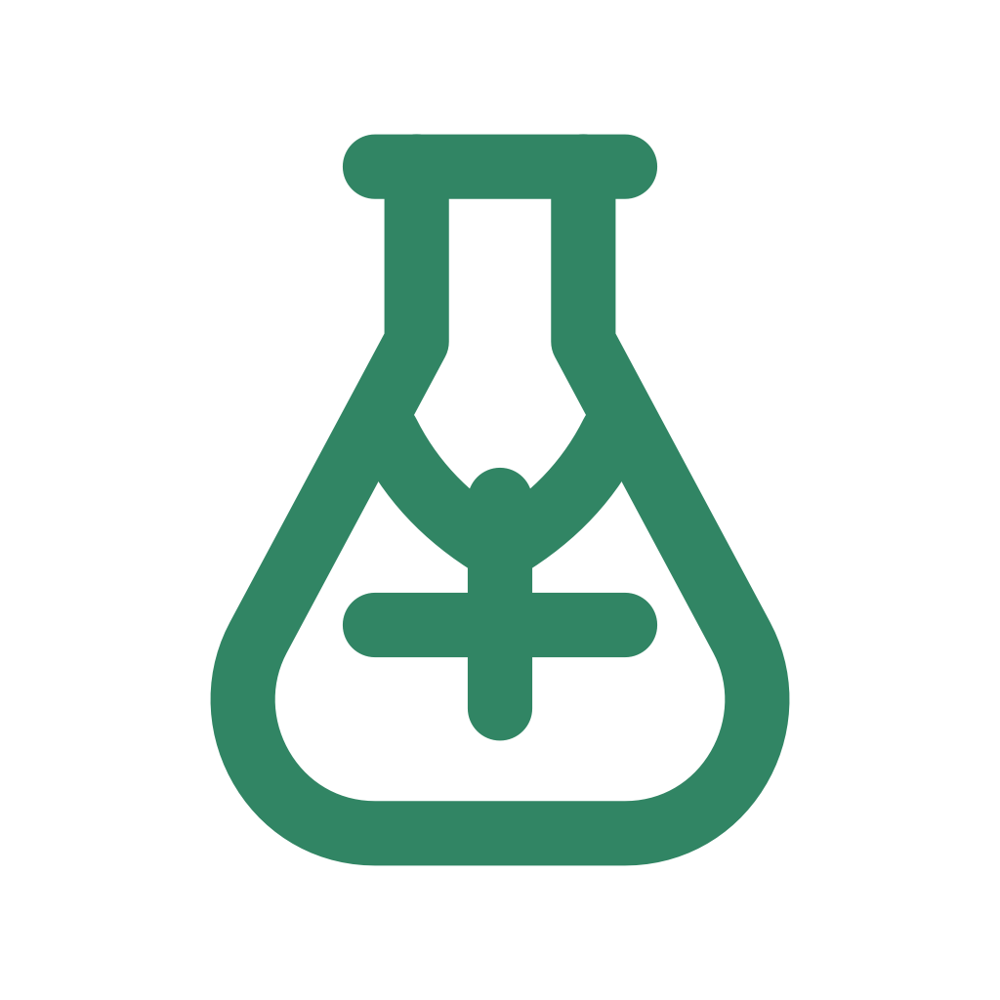

# Seqoya native application icon

The macOS application icon is the original transparent green flask and seedling. Preserve its color, geometry and transparency. The brown tile adaptation is superseded.

The geometry matches the preserved `heritage/renderer/apps/seqoya/src/SeqoyaGlyph.svelte` and maintained `src/components/WorkspaceGlyph.svelte`. The original native ICNS was recovered from the retained `g6-origin-source14-20261004-r1/Arbol/apps/Seqoya Lab.app/Contents/Resources/SeqoyaLab.icns` bundle. Its SHA-256 is `0cab915fd66cff44509cf1bffa510314d67bddc2ca401722a65f83cd07c2e0aa`.

The maintained 1024-pixel PNG in `src/assets/SeqoyaLab.png` is an export of that ICNS. Its SHA-256 is `4a6b77e7a5d456f92d03030b20a77207e4022c432b317d10448ed942a2d11931`.

The native implementation packages the exact original ICNS from `arbol-app/Resources/SeqoyaLab.icns`, independently of the pinned renderer snapshot. Both native and maintained design assets therefore preserve the same original mark. The renderer's older image snapshot is not a native release input.

